# Antigravity Storage Manager

<p align="center">
  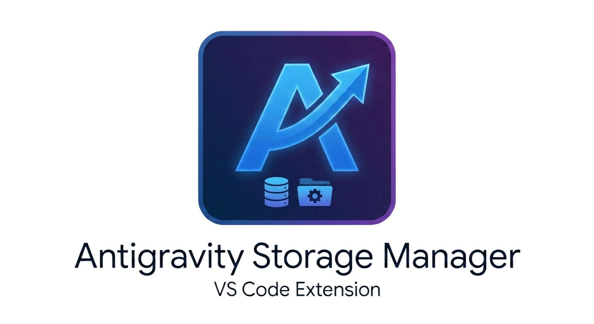
</p>

<p align="center">
  <strong>Unified AI Gateway with visual dashboard, secure Google Drive sync, Telegram notifications, multi-account profiles, real-time quota monitoring, Proxy support, MCP server, and advanced backup tools.</strong><br>
</p>

<p align="center">
  <a href="https://marketplace.visualstudio.com/items?itemName=unchase.antigravity-storage-manager">
    
  </a>
  <a href="https://marketplace.visualstudio.com/items?itemName=unchase.antigravity-storage-manager">
    
  </a>
  <a href="https://img.shields.io/open-vsx/v/unchase/antigravity-storage-manager">
    
  </a>
  <a href="https://open-vsx.org/extension/unchase/antigravity-storage-manager">
    
  </a>
  <a href="https://github.com/unchase/antigravity-storage-manager/blob/master/LICENSE">
    
  </a>
</p>

## Support

If you find this extension useful, consider supporting the development:

<a href="https://www.patreon.com/unchase">
  
</a>
<a href="https://www.buymeacoffee.com/nikolaychebotov">
  
</a>

---

## Features

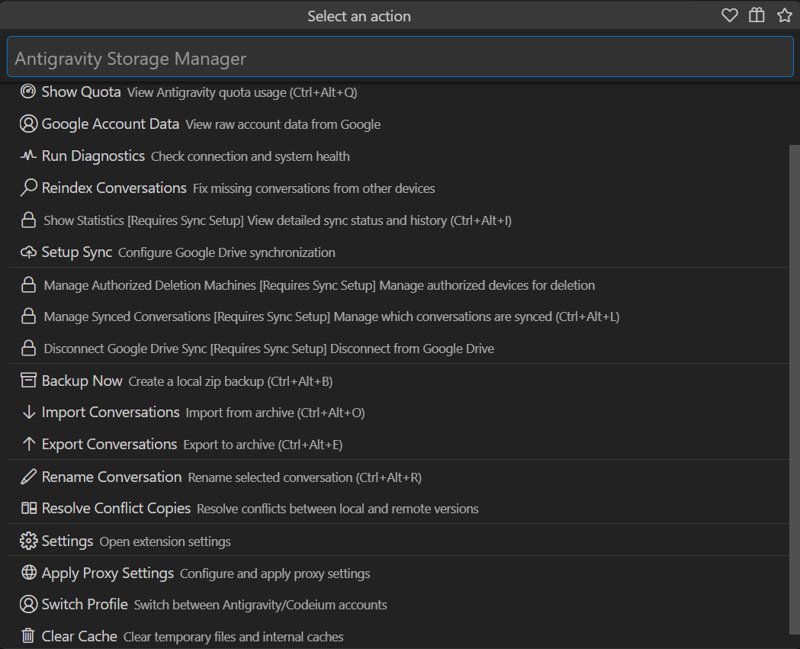

- 🚀 **Antigravity Proxy** — Unified AI Gateway with visual dashboard to manage multiple AI providers (Antigravity, Copilot, Claude, Codex, Gemini, Gemini CLI, Qwen, Kimi, Z.AI, and more) through a single endpoint.
- 🤖 **Telegram Bot Integration** — Real-time quota alerts, system stats, and remote sync control via interactive bot with out-of-band confirmation security.
- 👤 **Multi-Account Profiles** — Seamlessly switch between different Antigravity / Antigravity IDE accounts (e.g., Personal vs Work) with separate quotas and settings.
- 📊 **Advanced Quota Dashboard** — Comprehensive real-time tracking of consumption speed, reset cycles, and remaining time estimates for Gemini 4 (Neon, Carbon, Argon, Hydrogen), Orchestrator, Gemini 3.8 Flash, Claude 5.5 (Opus / Sonnet), and GPT-OSS models via `agy --hub` or `language_server`, with collapsible model groups, search/pinned filters, modality badges, and disabled/unavailable model indicators with hover tooltips.
- 🔌 **MCP Server Monitoring** — Monitor the connection status and resource availability of your Model Context Protocol servers.
- ☁️ **Google Drive & Local Sync** — Automatically sync conversations (`.db` + SQLite WAL and `.pb`) between devices using encrypted Google Drive or a local/network folder with parallel processing.
- 🌍 **Global Localization** — Native support for **16 languages** (English, Russian, Chinese, Japanese, Korean, German, French, Spanish, Italian, Portuguese, Polish, Vietnamese, Arabic, Czech, Turkish).
- 🔄 **Live Updates** — Seamlessly syncs data between the status bar and dashboard every minute for up-to-the-second accuracy.
- 🔍 **Account Insights** — View your avatar, copyable email, Plan/Tier, Default Model, Telemetry status, Prompt/Flow/Flex Credits, Plan Limits, 10 Feature flags, deprecation notices, and raw Google API responses.
- 🛡️ **Proxy Support** — Full support for corporate proxies with authentication and strict SSL configuration.
- 📦 **Export/Import** — Backup conversations to ZIP archives individually or in bulk with conflict detection.
- 📝 **Markdown Export** — Export conversations as readable `.md` files with message grouping and brain artifacts included.
- 🛑 **Cancellation Support** — Abort long-running operations (Sync, Export, Backup) safely at any time.
- 🛠️ **Smart Configuration** — Auto-detects missing sync setup and prompts for configuration on startup.
- 📱 **Multi-Profile Quota Display** — Intelligently combined quota usage for all accounts linked to active profiles on a specific device, with a scrollable and collapsible UI.
- 📝 **Customizable Pinned Models** — Cleanly save custom model IDs with human-readable labels and advanced validation.

---

## Google Drive Synchronization (New!)

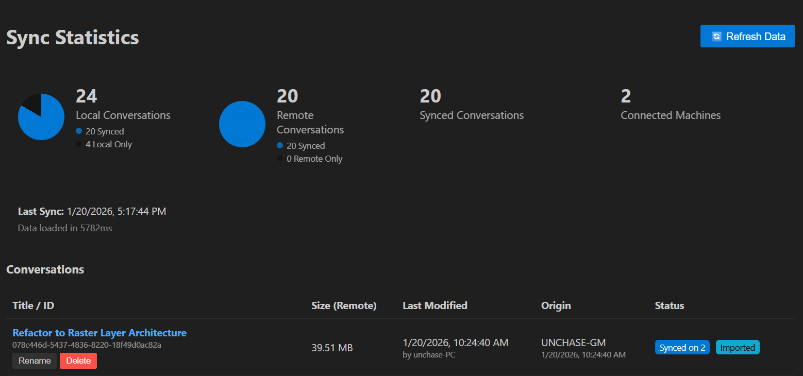

Keep your conversations synchronized across multiple machines using your Google Drive.

### Setup Sync
1. Run command `Antigravity Storage: Setup Google Drive Sync`
2. **Authentication**: Log in with your Google account.
3. **Session Setup**:
    - **New Session**: Create a new device entry (e.g., "Work Laptop").
    - **Resume Session**: Reconnect to an existing device ID from the list to avoid duplicates.
4. **Master Password**: Create or confirm your master password to encrypt your data.
5. **Done!** Conversations will automatically sync in the background.

👉 **[Detailed Setup Guide](https://github.com/unchase/antigravity-storage-manager/blob/master/SYNC_SETUP.md)**: Includes step-by-step instructions for configuring Google Cloud Console, adding test users, and troubleshooting.

### Security
- **Zero Knowledge (`AGSYNC03`)**: All data is encrypted locally with **AES-256-GCM** (authenticated `AGSYNC03` header with GCM AAD, 600,000 PBKDF2 iterations, and zeroized key material) before being uploaded.
- **Master Password**: Only you know the password. It is stored securely in your OS keychain, and transient network errors or wrong passwords never overwrite an existing remote manifest.
- **Hardened OAuth2 & Archives**: Google OAuth2 uses PKCE (`S256`), constant-time CSRF `state` verification, and loopback-only (`127.0.0.1`) callback binding. Sync, backup, and import enforce strict path containment and Gzip/Zip bomb limits.
- **Limited Access**: The extension only accesses files it created (`AntigravitySync` folder), and the `local` storage provider works completely without Google OAuth.

### Manual Sync
- Click the **AG Sync** button in the status bar
- Or run `Antigravity Storage: Sync Now`

### Manage Sync
- Click the **AG Sync** button in the status bar to open the menu.
- **Status Bar Tooltip**: Hover over "AG Sync" to see your Last Sync time and session Sync Count.
- **Devices Dashboard**: Run `Antigravity Storage: Show Statistics` (or `Ctrl+Alt+I`) to view the interactive dashboard:
    - **Connected Devices**: Visualize sessions grouped by machine (e.g., "Home PC").
    - **Status Indicators**: See which sessions are **Online** (Green) or **Offline** (Red) based on recent activity.
    - **Quota Tracking**: Monitor quota usage (Credits/Limits) for each active session.
    - **Manage Conversations**: Rename, **Archive / Unarchive** (exclude from sync without moving files), or Delete conversations directly from the list, with **`Active`**, **`Archived`**, and **`All`** filter tabs.
    - **Selective Sync**: Manually **Upload** (Local Only) or **Download** (Remote Only) individual active conversations.
    - **Visual Analytics**: Interactive pie charts showing sync coverage (Local vs Synced, Remote vs Synced).
    - **Machine Management**:
      - **Delete (🗑️)**: Remove stale machines and their sessions.
      - **Force Push (🔄)**: Send a sync signal to other devices.
    - **User Info**: Displays the current user's email and plan (from Google AI Studio or Google Drive).
    - **Active Transfers**: Monitor ongoing uploads and downloads in real-time. **Click** on any item to open the conversation instantly.
    - **Force Sync (🚀)**: Manually trigger a forceful synchronization that bypasses local caches and flushes server buffers.
    - **Real-time Data**: Information is automatically refreshed during sync events; you can also use the **Refresh Data (🔄)** button to reload manually.
- **Status Bar**: The **AG Sync** icon updates dynamically (☁️ Cloud, 🔄 Spinning, ⚠️ Error, ✅ Check) to reflect the current state.
- **Shortcuts**: Default hotkeys are provided for common actions (e.g., `Ctrl+Alt+S` for Sync Now) and are displayed in the menu.

---

## Account & Quota Dashboard (New!)

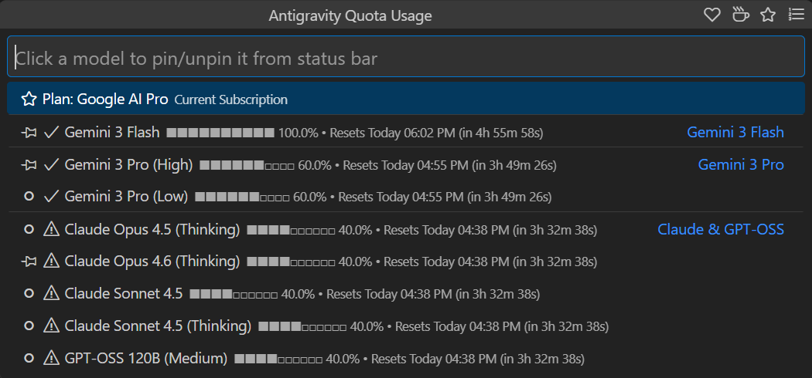

*(Fig. 1: Quota Dashboard showing models sorted by Quota)*

Monitor your AI usage limits and remaining credits directly within VS Code.

### Features
- **Real-time Synchronization**: The dashboard automatically refreshes data every minute, staying perfectly in sync with the status bar, and includes a manual **Refresh (🔄)** button plus quick links to **Show Statistics (📊)** and **Switch Profile (👤)**.
- **Antigravity IDE & `agy` Hub / CLI Support**: Automatically discovers local `language_server` / `agy` (`--hub` / `--hub-port`) processes and `ANTIGRAVITY_LS_ADDRESS` / `ANTIGRAVITY_CSRF_TOKEN` environment variables across HTTPS and HTTP, with automatic fallback from `GetUserStatus` to `RetrieveUserQuotaSummary` and the official Antigravity CLI (`agy -p /usage --output-format json`) for 5-hour and weekly quota windows.
- **Rich Profile & Plan Analysis**: Displays your profile avatar, click-to-copy email, exact plan name and tier description, dynamic **Upgrade Plan** link (from `upgradeSubscriptionUri`), **Default Model**, **Telemetry** status, and **Plan Limits** (Max Chat Input Tokens, Custom Instructions, Premium Messages, Pinned Context Items).
- **Prompt, Flow & Flex Credits**: Tracks remaining balances for **Prompt Credits**, **Flow Credits**, and available **Flex Credits** purchase allowances (when `showCreditsBalance` is enabled).
- **Collapsible Model Groups & Toolbar**: Models are grouped identically to the QuickPick (`Claude & GPT-OSS`, `Gemini`), collapsed by default with group-level remaining quota, cycle progress, and reset time. Includes live **Search**, **Pinned only** filter, and **Expand All / Collapse All** controls.
- **Unavailable Models, Badges & Hover Tooltips**: Tier-restricted (`allowedTiers`) or disabled models are clearly marked as unavailable (`🔒` / `🚫`), locked from pinning, and display Antigravity-style hover tooltips and status badges (`New`, `Leaving Soon`, `Notice`, `Unavailable`) across the QuickPick, **Account Information**, and **Sync Statistics** views.
- **Deprecation Banner, Modalities & Copyable Model IDs**: Highlights upcoming removals (`Leaving Soon` / `Notice`) in a dedicated **Model Deprecation Notices** banner, shows supported model modalities (`🖼️` Images, `📄` Documents, `🎵` Audio, `🎬` Video), and lets you copy canonical `modelId` values in one click.
- **Model Monitoring**: Pin specific models (e.g., Gemini 4 Neon/Carbon/Argon/Hydrogen, Orchestrator, Gemini 3.8 Flash, Claude Opus/Sonnet 5.5, GPT-OSS 120B) to the status bar with compact readable abbreviations.
- **Feature Availability**: Check which of 10 plan features (Web Search, Browser Tool, Experimental Browser, Knowledge Base, Auto-run Commands, Generate Commit Messages, MCP Servers, Fast Autocomplete, Tab to Jump, Background Agents) are enabled for your subscription.
- **Visual Indicators & Cycle Tracking**: Color-coded status dots (🟢/🟡/🟠/🔴), progress bars, usage history sparklines, and visual 5-hour/weekly cycle indicators show usage at a glance.
- **Detailed Statistics**: Precise counters for request usage and token limits for every model.

### Usage
1. Click the **AG Quota** (`AGQ`) indicator in the status bar (or run `Antigravity Quota: Show Quota`).
2. Pin/Unpin models by clicking on them in the menu.
3. The status bar auto-updates every minute.

### Status Bar & Settings

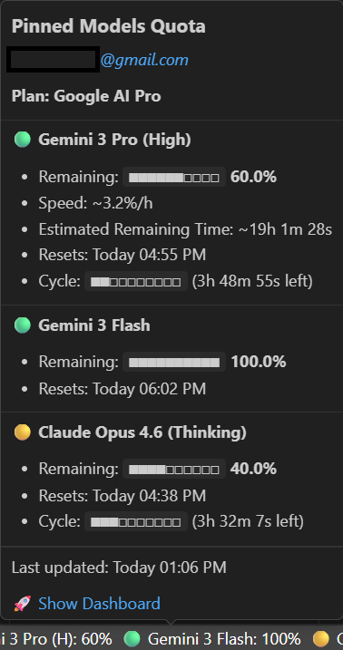

*(Fig. 2: Rich Tooltip)*

- Hover over the database icon in the status bar to see a rich tooltip with pinned model details.
- Configure which models to pin in your User Settings.

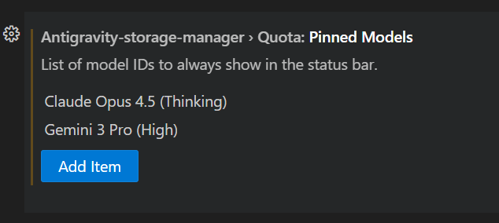

*(Fig. 3: Settings UI)*

---

## MCP Server Monitoring (New!)

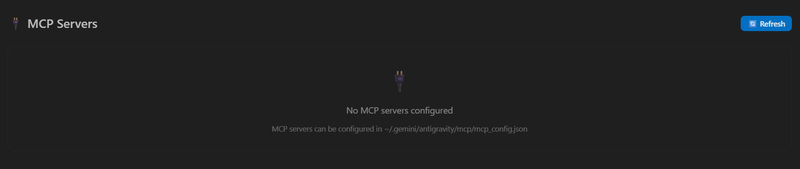

*(Fig. 4: MCP Server Status Panel)*

Monitor your Model Context Protocol (MCP) server connections directly from the Sync Statistics Dashboard.

### Features
- **Connection Status**: Real-time status indicators (🟢 Connected, 🟡 Pending, 🔴 Error, ⚪ Disconnected) for each server.
- **Tool & Resource Overview**: Quickly see the number of tools and resources available on each MCP server.
- **Error Diagnostics**: Detailed error messages are displayed for servers that fail to connect.
- **Manual Refresh**: Reconnect to all configured MCP servers with a single click.

### Configuration
MCP servers are configured in `~/.gemini/antigravity/mcp_config.json` (legacy path `~/.gemini/antigravity/mcp/mcp_config.json` is also supported). The panel will automatically display all servers defined in your configuration.

---

## Antigravity Proxy – Unified AI Gateway (New!)

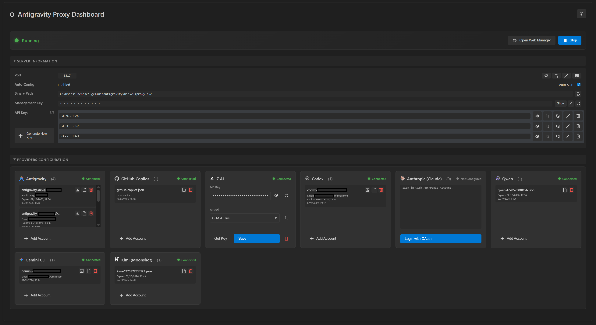

*(Fig. 5: Antigravity Proxy Dashboard)*

The **Antigravity Proxy** is a local proxy server that unifies access to multiple AI providers through a single OpenAI-compatible endpoint. Manage all your AI providers from a beautiful visual dashboard without leaving VS Code.

### Supported Providers
- **OAuth Providers** (one-click Sign In):
    - **Antigravity** (Google AI Studio)
    - **Gemini CLI** (Google Cloud Code)
    - **Codex** (OpenAI Codex CLI)
    - **Claude** (Anthropic OAuth / API Key)
    - **Qwen** (Alibaba)
    - **Kimi** (Moonshot)
    - **GitHub Copilot** (using VS Code's built-in authentication)
- **API Key Providers**:
    - **Claude** (Anthropic)
    - **Gemini** (Google AI)
    - **Z.AI** (GLM-4 Plus, GLM-4.7, GLM-4.6)
    - **Vertex** (Google Cloud)
    - **Kiro** (AWS)

### Dashboard Features
- **Provider Cards**: Each provider is displayed as an interactive card with:
    - **Status Badge**: Connected (🟢), Not Configured (⚪), or Error (🔴)
    - **Actions**: Sign In, Configure, Test Connection, Delete Auth
    - **Multi-Account Support**: Manage multiple authentication tokens per provider
- **API Keys Management**: Generate, view, enable/disable, and delete local API keys.
- **Management Secret Key**: Securely manage the proxy's Web UI password.
- **Proxy Control**: Start, Stop, and Restart the proxy directly from the dashboard.
- **Status Bar**: Real-time indicator (`AG Proxy: ON/OFF`) in the VS Code status bar.

### Quick Start
1. Open Command Palette (`Ctrl+Shift+P`).
2. Run `Antigravity Proxy: Dashboard`.
3. If the proxy binary is not installed, click **Install Proxy** to download it automatically.
4. Click **Start Proxy** to launch the server.
5. Configure your providers by clicking **Sign In** or **Configure** on their cards.
6. Use the generated API Key in your applications with endpoint `http://127.0.0.1:8317/v1`.

### Configuration
- **Port**: `antigravity-storage-manager.proxy.port` (default: `8317`)
- **Auto-Start**: `antigravity-storage-manager.proxy.enabled` — Start proxy automatically when VS Code launches.
- **Auto-Configure**: `antigravity-storage-manager.proxy.autoConfig` — Automatically configure VS Code proxy settings when started.
- **Upstream Proxy**: `antigravity.config.proxy.upstreamUrl` — Route proxy traffic through corporate proxy.
- **Binary Path**: `antigravity-storage-manager.proxy.binaryPath` — Custom path to `cliproxy` executable.

### Commands
- `Antigravity Proxy: Dashboard` — Open the visual dashboard.
- `Antigravity Proxy: Start` — Start the proxy server.
- `Antigravity Proxy: Stop` — Stop the proxy server.
- `Antigravity Proxy: Install` — Download and install the proxy binary.
- `Antigravity Proxy: Show Log` — Open the proxy output channel for debugging.
- `Antigravity Proxy: Open Config` — Edit `config.yaml` directly.

---

## Antigravity Proxy MCP Server

The extension includes a built-in **Model Context Protocol (MCP)** server that wraps the Antigravity Proxy. This allows AI clients to directly interact with the proxy and its configured providers (including Gemini 4 Neon/Carbon/Argon/Hydrogen, Orchestrator, Gemini 3.8 Flash, Claude 5.5, and GPT-OSS 120B) using standard tools.

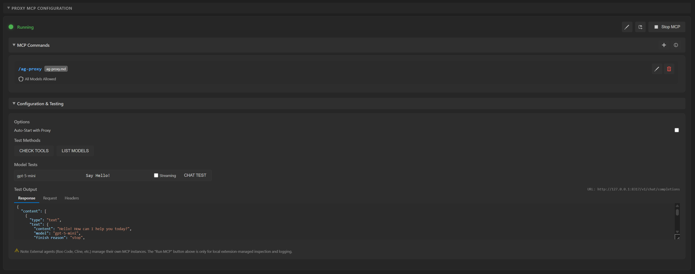

### Capabilities
- **`proxy_status`**: Check status, port, and configured providers.
- **`list_models`**: Get a list of all available AI models.
- **`chat_completion`**: Send standard chat completion requests.
- **`get_quota`**: View quota usage for Antigravity, Gemini CLI and Codex.

### Configuration
Add the server to your `mcp_config.json`:

```json
{
  "mcpServers": {
    "antigravity-proxy": {
      "command": "node",
      "args": ["<PATH_TO_EXTENSION>/dist/mcp/proxyMcpServer.js"],
      "env": {
        "PROXY_PORT": "8317"
      }
    }
  }
}
```

---

## Corporate Proxy Configuration

If you are behind a corporate proxy, you can configure Antigravity to route its internal requests through your proxy server.

### Setup
1. Open Settings (`Ctrl+,`).
2. Search for `antigravity proxy`.
3. Configure:
    - **Proxy URL**: `http://my-proxy:8080`
    - **Username/Password**: (Optional) For authenticated proxies.
    - **Strict SSL**: Enable/disable certificate verification.
4. Run command `Antigravity: Apply Proxy Settings` to apply these settings to your VS Code profile globally.

> **Note**: This command updates the global `http.proxy` setting in VS Code to ensure the Antigravity Language Server respects your proxy configuration.

---

## Telegram Bot Integration (New!)

Receive real-time notifications about your quota usage, system statistics, and sync status directly in Telegram. You can also control Antigravity efficiently using interactive commands.

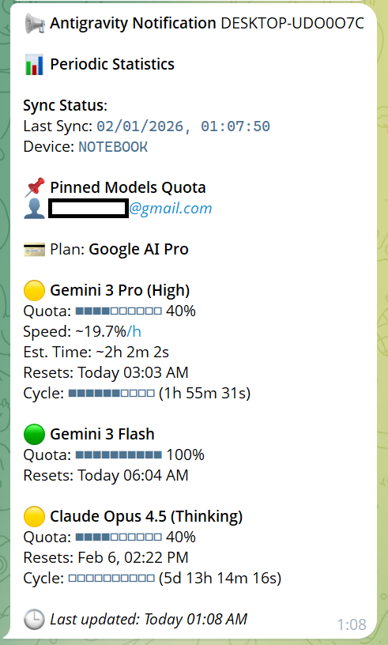

### Features
- **Quota Alerts**: Get notified when your AI credit balance is low or when quotas reset.
- **Visuals**: Messages include ASCII progress bars for quota usage and reset cycles, and display the linked account email.
- **Interactive Commands**:
    - `/stats` — View system resource usage (CPU, RAM) and uptime.
    - `/sync` — Trigger a synchronization remotely.
    - `/ping` — Check bot health.
- **Secure Access**: Restrict bot access to specific Telegram User IDs or Usernames. Linking a `@username` requires out-of-band confirmation via a 6-digit verification code displayed in VS Code (with brute-force rate limiting). Unauthorized users receive an instant "Access Denied" response with their Chat ID for easy configuration.

### Setup Guide

1. **Create a Telegram Bot**:
    - Open [BotFather](https://t.me/BotFather) in Telegram.
    - Send `/newbot` and follow the instructions to create a bot.
    - Copy the **HTTP API Token** provided by BotFather.

2. **Configure Extension**:
    - Open VS Code Settings (`Ctrl+,`).
    - Search for `antigravity telegram`.
    - Set **Bot Token**: Paste your API Token.
    - Set **Allowed User IDs**: (Optional) Array of numeric Telegram User IDs allowed to interact with the bot.
    - Set **Allowed Usernames**: (Easier) Array of Telegram usernames (without `@`) allowed to use the bot (e.g., `["your_username"]`).
    - **Note**: For usernames to work, you must start a chat with the bot first so it can resolve your Chat ID.

3. **Start the Bot**:
    - The bot starts automatically when VS Code launches if the token is configured.
    - Send `/start` or `/help` to your bot to begin.

### Configuration Options
- `antigravity-storage-manager.telegram.botToken`: Your bot's API token.
- `antigravity-storage-manager.telegram.userIds`: List of authorized numeric user IDs.
- `antigravity-storage-manager.telegram.usernames`: List of authorized usernames (requires 6-digit confirmation code in VS Code on first link).
- `antigravity-storage-manager.telegram.statsIntervalCron`: Cron expression for periodic stats (default: `0 */12 * * *` — every 12 hours).

---

## Profile Switching (New!)

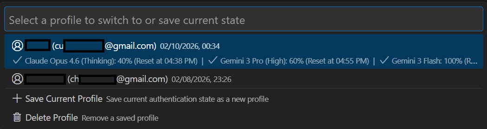

*(Fig. 6: Profile Switching)*

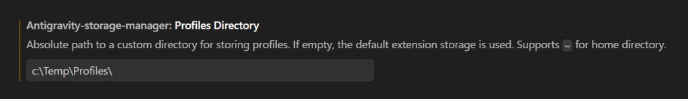

*(Fig. 7: Profile Settings)*

Easily switch between different Antigravity accounts (e.g., Personal vs Work) with separate quotas, limits, and authentication states.

### Features
- **Multi-Account Support**: Maintain distinct authentication sessions for different Google accounts.
- **Persistent Storage**: Configure a custom directory to store your profiles, ensuring they survive extension updates or uninstalls.
- **Quick Switch**: Use the `Antigravity Storage: Switch Profile` command to instantly toggle between environments.

### Usage
1. Run `Antigravity Storage: Switch Profile` from the Command Palette.
2. Select **"Save Current Profile"** to store your current session.
3. Select **"Create New Profile"** (or switch to an existing one) to start fresh.
4. **Note**: A window reload is required to apply the profile switch.

### Configuration
By default, profiles are stored in the extension's global storage. To prevent data loss upon uninstallation, set a custom path in settings:
- **Setting**: `antigravity-storage-manager.profilesDirectory`
- **Value**: Absolute path to your desired folder (e.g., `C:\MyProfiles\Antigravity`).

---

## Google Account Data (Advanced)

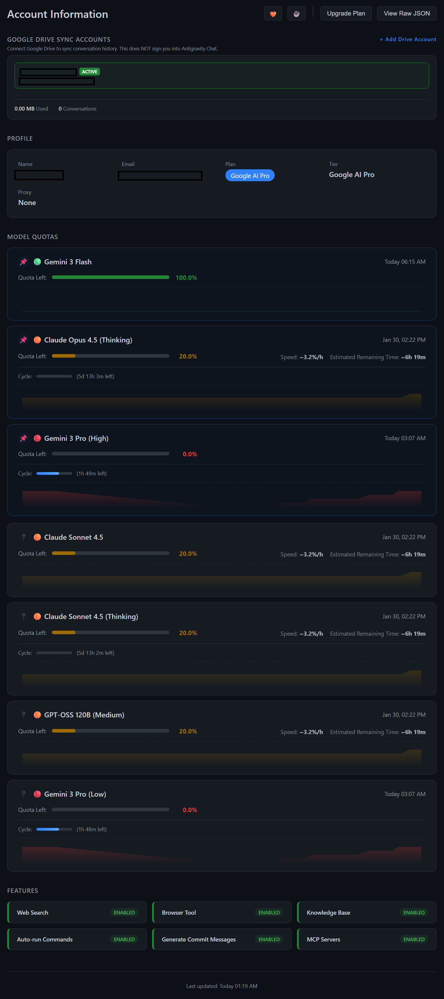

*(Fig. 8: Raw Account Data view)*

For power users and troubleshooting, you can view the raw JSON data received from the Google API. This includes detailed information about your account status, tier details, and all raw model quota limits.

### How to access:
1. Open the **AG Sync** menu from the status bar.
2. Select **Google Account Data**.
3. Or click the **View Raw JSON** button directly from the **Account Information** dashboard.

---

## Conversation Viewer

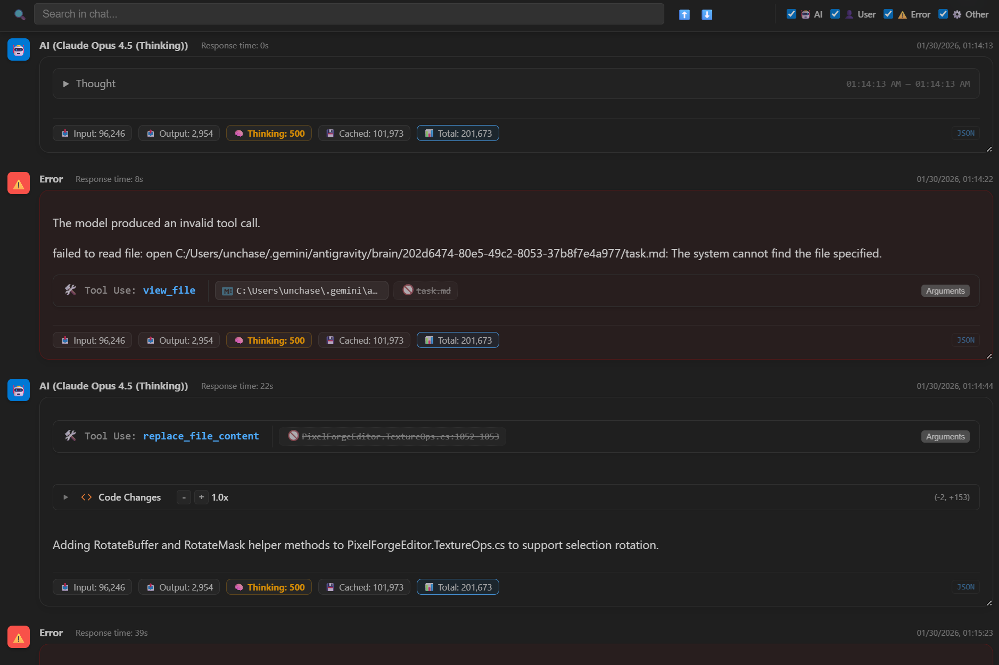

Need to review a long conversation without scrolling through the small chat window? Open any conversation in a full-screen, dedicated editor tab.

### Features
- **Distraction-Free Reading**: Full-width view optimized for readability.
- **Rich Markdown Support**: Code blocks, tables, and formatting rendered safely (strict nonce-based CSP, XSS hardening, and UNC path blocking).
- **Syntax Highlighting**: Complete language support for all code snippets.
- **Quick Access**: Just click on any conversation in the **Sync Statistics** dashboard or use the `Antigravity Storage: Open Current Conversation` command.

---

## How It Works (Export/Import)

### 1. Quick Access via Status Bar
 
The extension adds **AG Export**, **AG Import**, and **AG Sync** buttons to your VS Code status bar:

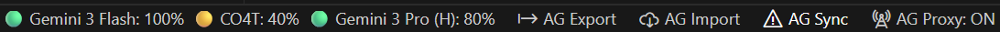

### 2. Command Palette Integration

All commands are available through the Command Palette (`Ctrl+Shift+P`). Just type "Antigravity Storage" to see all available actions.

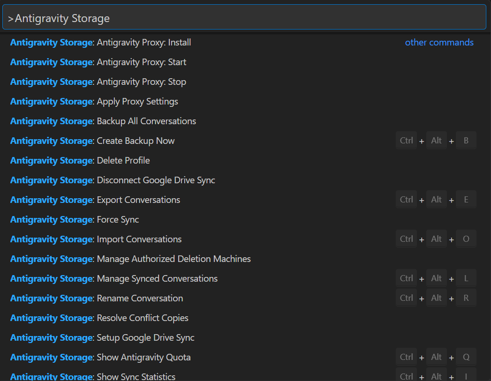

### 3. Multi-Select Export

When exporting, you can select **multiple conversations at once** using the Space key.

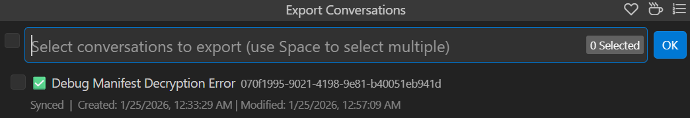

---

## Advanced Features

### 💾 Local Backup
Worried about the cloud? Create a full local backup anytime.
1. Run `Antigravity Storage: Backup All Conversations`
2. Choose a destination `.zip` file or folder (saving inside `brain/` or `conversations/` is blocked to prevent recursion).
3. A single ZIP file containing **all** your conversations is written atomically (skipping ephemeral SQLite `.db-shm` files).

### ⚔️ Conflict Resolution
When changes are made concurrently on multiple machines or offline (after a 3-way merge verifies a real conflict):
- **Automatic Policy**: Set `antigravity-storage-manager.sync.conflictResolution` to:
  - `prompt`: Prompt the user with options when conflicts are detected (default).
  - `keepLocal`: Always overwrite remote with local version.
  - `keepRemote`: Always overwrite local with remote version.
  - `keepNewer`: Keep whichever version was modified more recently (Last-Write-Wins).
  - `keepLarger`: Keep whichever version has the larger file size.
- **Batch Resolution & Keep Both**: When prompted, resolve all conflicting items in one click (**Keep All Local**, **Keep All Remote**, **Keep All Newer**, **Keep All Larger**) or inspect them **One-by-One** (including **Keep Both** for both legacy `.zip.enc` and per-file v2 sync).
- **Conflict Copies**: Run `Antigravity Storage: Resolve Conflict Copies` to safely inspect or transactionally replace offline conflict copies across both `brain/` and `conversations/`.

### 🔄 IDE State, Index Rebuilding & Data Migration
Antigravity IDE stores chat session history and active tab order in its global database (`state.vscdb`).
- **Rebuild Conversation Index**: Run `Antigravity Storage: Rebuild Conversation Index for IDE` to discover all local `.db` and `.pb` conversations, register them in the IDE chat sidebar (`state.vscdb`), and refresh the sync manifest index.
- **Export / Import IDE State**: Run `Antigravity Storage: Export IDE State (state.vscdb)` and `Antigravity Storage: Import IDE State (state.vscdb)` to back up or migrate your IDE chat history state between machines with SQLite/ZIP validation, automatic backup safety, and WAL/SHM cleanup.
- **Bidirectional Storage Migration**: Migrate conversations in either direction between `~/.gemini/antigravity` and `~/.gemini/antigravity-ide` while safely skipping ephemeral `.db-shm` files.

---

## Installation

### From VS Code Marketplace
1. Open VS Code
2. Go to Extensions (`Ctrl+Shift+X`)
3. Search for "Antigravity Storage Manager"
4. Click Install

### Requirements
- VS Code 1.96.0 or higher
- Google Account (for synchronization)

## Data Location

The extension automatically detects your active Antigravity storage root (`~/.gemini/antigravity-ide/` or `~/.gemini/antigravity/`), or uses your custom `antigravity-storage-manager.storagePath` setting:
- **Brain data:** `<storageRoot>/brain/`
- **Conversation files:** `<storageRoot>/conversations/` (supports both SQLite `.db`/`.db-wal` and legacy Protobuf `.pb` formats)

Synced data is stored in your Google Drive in the `AntigravitySync` folder (or in the configured `antigravity-storage-manager.sync.localPath` when using the `local` storage provider).

## Keyboard Shortcuts

The extension comes with default keybindings for common actions:
- `Ctrl+Alt+S` (Windows/Linux) / `Cmd+Alt+S` (Mac): **Sync Now**
- `Ctrl+Alt+I` (Windows/Linux) / `Cmd+Alt+I` (Mac): **Show Sync Statistics**
- `Ctrl+Alt+Q` (Windows/Linux) / `Cmd+Alt+Q` (Mac): **Show Quota**
- `Ctrl+Alt+B` (Windows/Linux) / `Cmd+Alt+B` (Mac): **Trigger Backup**
- `Ctrl+Alt+E` (Windows/Linux) / `Cmd+Alt+E` (Mac): **Export Conversations**
- `Ctrl+Alt+O` (Windows/Linux) / `Cmd+Alt+O` (Mac): **Import Conversations**
- `Ctrl+Alt+R` (Windows/Linux) / `Cmd+Alt+R` (Mac): **Rename Conversation**
- `Ctrl+Alt+L` (Windows/Linux) / `Cmd+Alt+L` (Mac): **Manage Sync**

### Customizing Shortcuts
You can customize these shortcuts to fit your workflow:
1. Open **Keyboard Shortcuts** (`Ctrl+K Ctrl+S`).
2. Type `antigravity` in the search bar.
3. Right-click on any command (e.g., `Antigravity Storage: Import Conversations`) and select **Change Keybinding**.


## Development

### Testing & Checks

Run full check (TypeScript typecheck, ESLint, and unit tests):
```bash
npm run check
```

Run all unit tests:
```bash
npm run test:unit
```

Run localization tests (validates all `package.nls.*.json` and `l10n/bundle.l10n.*.json` files):
```bash
npm run test:localization
```

Or run specific localization checks / sync scripts:
```bash
npm run test:nls           # Test package.nls.*.json files only
npm run test:l10n          # Test l10n/bundle.l10n.*.json files only
npm run sync:localization  # Check & sync missing keys across all locales
```

---

## Contributing

See [CONTRIBUTING.md](CONTRIBUTING.md) for development setup and contribution guidelines.

## License

[MIT](LICENSE) © [unchase](https://github.com/unchase)
