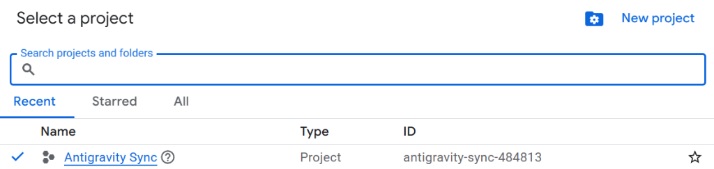
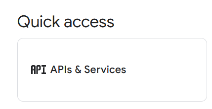
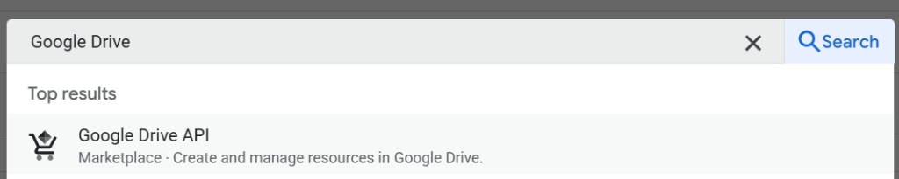
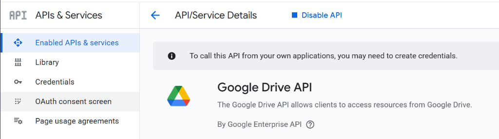
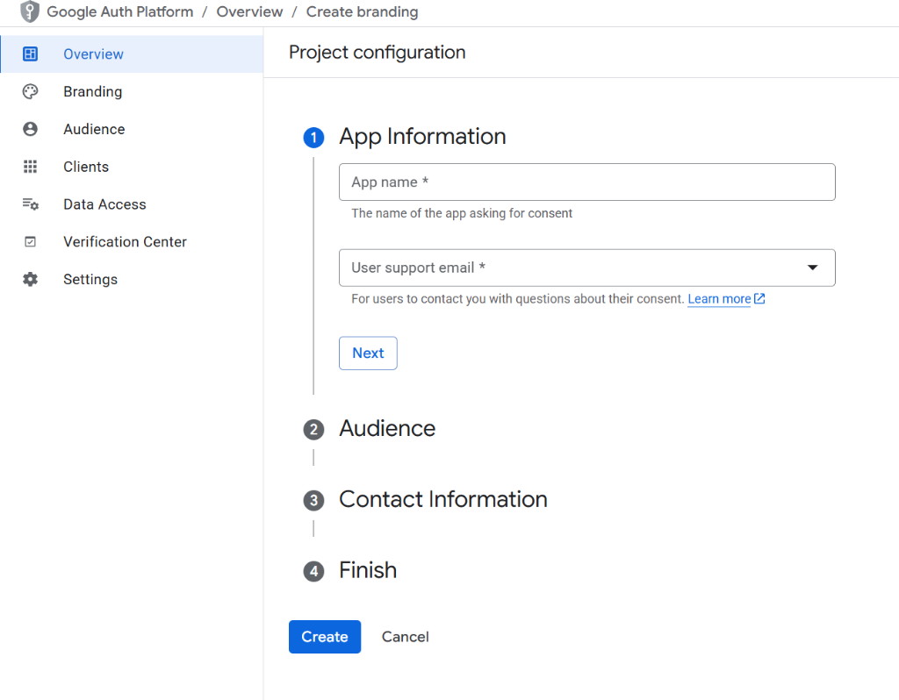
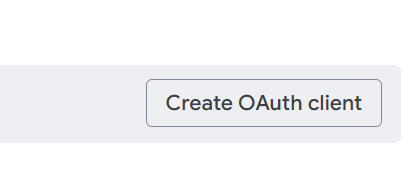
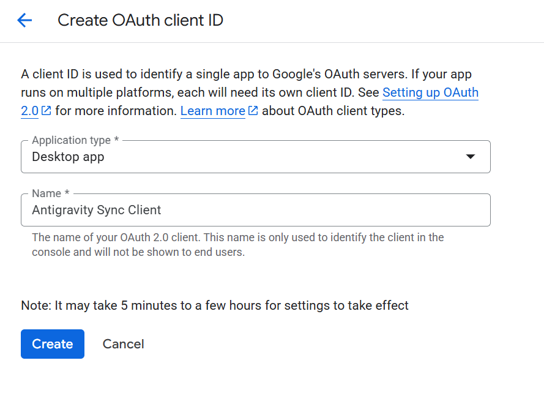
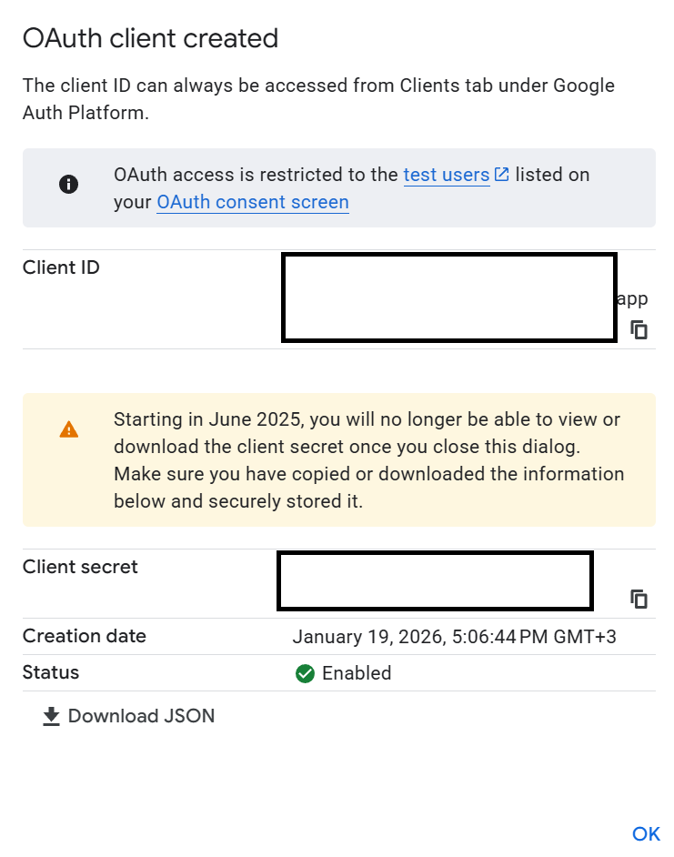
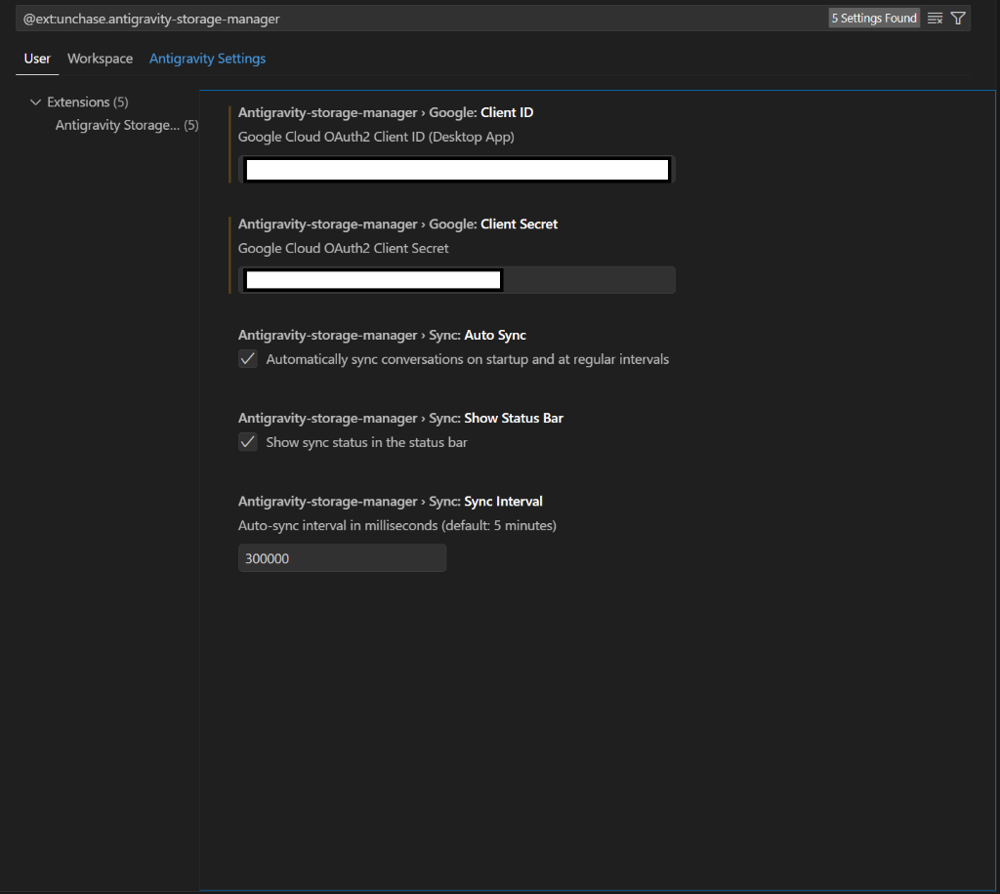
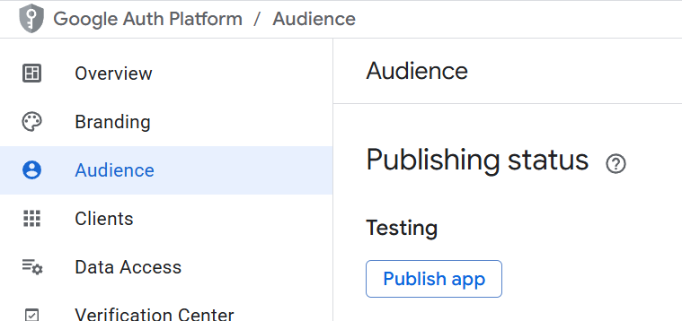

# Antigravity Synchronization Setup Guide

This guide describes how to set up and use the **Synchronization** feature in Antigravity Storage Manager. It supports both **Google Drive** (end-to-end encrypted cloud sync) and **Local / Network Folder** (`sync.storageProvider: "local"`) to keep your AI conversation history (`.db` + SQLite WAL and `.pb`) synchronized across multiple computers.

## Prerequisites

1. **VS Code** or **Antigravity IDE** (version 1.96.0 or higher).
2. **Antigravity Storage Manager** extension installed.
3. A **Google Account** (Gmail) if using Google Drive sync (not required for the `local` storage provider).

> **Tip (Local / NAS / Cloud Folder Sync):** If you prefer syncing via a local, NAS, Dropbox, or OneDrive folder without Google Cloud setup, open Settings (`Ctrl+,`), set `antigravity-storage-manager.sync.storageProvider` to `local`, and specify `antigravity-storage-manager.sync.localPath`. Then skip straight to Step 1 (Master Password & Initial Sync).

---

## Step 0: Google Cloud Configuration (Required)

Because this is a developer extension, you must provide your own Google OAuth2 credentials.

1. Go to the [Google Cloud Console](https://console.cloud.google.com/).
2. Create a **New Project** (e.g., "Antigravity Sync").

   

3. Go to **APIs & Services > Library**, search for **Google Drive API**, and **Enable** it.

    
   
   

4. Go to **APIs & Services > OAuth consent screen**:
   - Choose **External** (or Internal if you have a Workspace).
   - Fill in required fields (App name, email).
   - Add your email as a **Test User**.

   

5. Go to **APIs & Services > Credentials**:
   - Click **Create Credentials > OAuth client ID**.

     

   - Application type: **Desktop app**.
   - Name: "Antigravity Sync Client".
   - Click **Create**.

     

6. Copy your **Client ID** and **Client Secret**.

     

7. In VS Code:
   - Go to **Settings** (`Ctrl+,`).
   - Search for `Antigravity`.
   - Paste your **Client ID** and **Client Secret** into the respective fields.
     

---

## Step 1: Setting Up the First Machine

Start with the computer that has the conversations you want to sync.

1. **Open VS Code**.
2. Open the **Command Palette** (`Ctrl+Shift+P` or `Cmd+Shift+P` on Mac).
3. Type and run the command: `Antigravity Storage: Setup Google Drive Sync`.
4. **Create a Master Password**:
   - You will be asked to create a **Master Password**.
   - ⚠️ **Important:** Create a strong password and **remember it**. You will need this *exact* same password to set up your other computers.
   - This password is used to encrypt all your conversations before they are uploaded to Google Drive. Neither Google nor anyone else can read your data without it.
5. **Authenticate with Google**:
   - A browser window will open asking you to sign in to Google.
   - Authorize the application to access its specific folder in your Google Drive.
   - Once confirmed, close the browser window and return to VS Code.
6. **Initial Sync**:
   - The extension will automatically create a secure folder (`AntigravitySync`) in your Google Drive.
   - Your existing conversations will be encrypted and uploaded.
   - Check the status bar: you should see the **AG Sync** icon.

---

## Step 2: Setting Up Additional Machines

Now, set up synchronization on your second computer (e.g., your home laptop).

1. **Install the Extension** on the second computer.
2. Open the **Command Palette** and run: `Antigravity Storage: Setup Google Drive Sync`.
3. **Authenticate**: Sign in with the **same Google Account** you used on the first machine.
4. **Join Existing Sync**:
   - The extension will detect the existing `AntigravitySync` folder in your drive.
   - It will ask if you want to join the existing sync. Select **"Join Existing"**.
5. **Enter Master Password**:
   - Enter the **Master Password** you created in Step 1.
   - *Note: If you enter the wrong password, the extension won't be able to decrypt your data.*
6. **Done!**
   - The extension will download and decrypt conversations from your Drive.
   - New conversations created here will automatically sync to your first machine.

---

## How it Works

- **Auto-Sync**: By default, the extension checks for changes every **5 minutes**.
- **Manual Sync**: You can force a sync anytime by clicking the **AG Sync** button in the Status Bar or running `Antigravity Storage: Sync Now`.
- **Encryption (`AGSYNC03`)**: All data (conversations and metadata) is encrypted locally with **AES-256-GCM** (authenticated `AGSYNC03` header with GCM AAD and 600,000 PBKDF2 iterations) using your Master Password. Stored files are unreadable without your password.
- **SQLite WAL Atomicity**: `.db` and `.db-wal` files are synchronized as a single atomic unit, and stale `.db-wal` / ephemeral `.db-shm` files are cleaned up on overwrite so SQLite databases stay consistent across machines.
- **Remote Manifest Safety**: If a network error occurs or an incorrect Master Password is entered, the extension aborts rather than overwriting an existing remote manifest with an empty one.
- **Local / Network Folder Provider**: When `sync.storageProvider` is set to `local`, synchronization runs completely without Google OAuth and uses atomic exclusive (`wx`) lock files with a 5-minute TTL.

## Managing Conflicts

The sync engine runs a **3-way merge** first so clean single-side edits never trigger false conflicts. If you edit the same conversation on multiple computers while offline, a **Conflict** is detected and resolved according to `antigravity-storage-manager.sync.conflictResolution`:

- **`prompt`** *(default)*: Prompts you with single-click batch options (**Keep All Local**, **Keep All Remote**, **Keep All Newer**, **Keep All Larger**) or **Review One-by-One** (including **Keep Both**, which saves a `-conflict` copy for both legacy `.zip.enc` and per-file v2 sync).
- **`keepLocal`**: Always overwrites the remote version with your local version.
- **`keepRemote`**: Always overwrites your local version with the remote version.
- **`keepNewer`**: Automatically keeps the most recently modified version (Last-Write-Wins).
- **`keepLarger`**: Automatically keeps whichever version has the larger file size.

## Troubleshooting

### "Incorrect Password" Error
If you see this on a new machine, it means the password you entered doesn't match the one used to encrypt the data. Your existing remote backup is **never** overwritten on decryption failure.
- Run `Antigravity Storage: Disconnect Google Drive Sync`.
- Run setup again and enter the correct password.

### OAuth2 Callback Blocked or Times Out
For security, the local OAuth2 callback server binds exclusively to loopback `http://127.0.0.1:47842` and enforces PKCE (`S256`) plus CSRF `state` verification. Make sure local firewall rules allow loopback connections on port `47842` and complete sign-in from the latest browser tab opened by the extension.

### Error 403: access_denied (App not verified)
If you see a screen saying **"Access blocked: application has not passed Google verification"**:
1. Go to **Google Cloud Console** > **APIs & Services** > **OAuth consent screen** (or **Google Auth Platform**).
2. In the left sidebar, click on **Audience**.

   

3. Scroll down to the **Test users** section and click **+ ADD USERS**.
4. Enter your email address (the one you are trying to log in with).
5. Save and try again.

### Resetting Everything
If you lost your Master Password or want to start over:
1. **Disconnect** the extension on all machines (`Antigravity Storage: Disconnect Google Drive Sync`).
2. Go to your **Google Drive** (in a web browser).
3. Delete the folder named `AntigravitySync`.
4. Run setup again on your main machine to create a new sync store with a new password.
